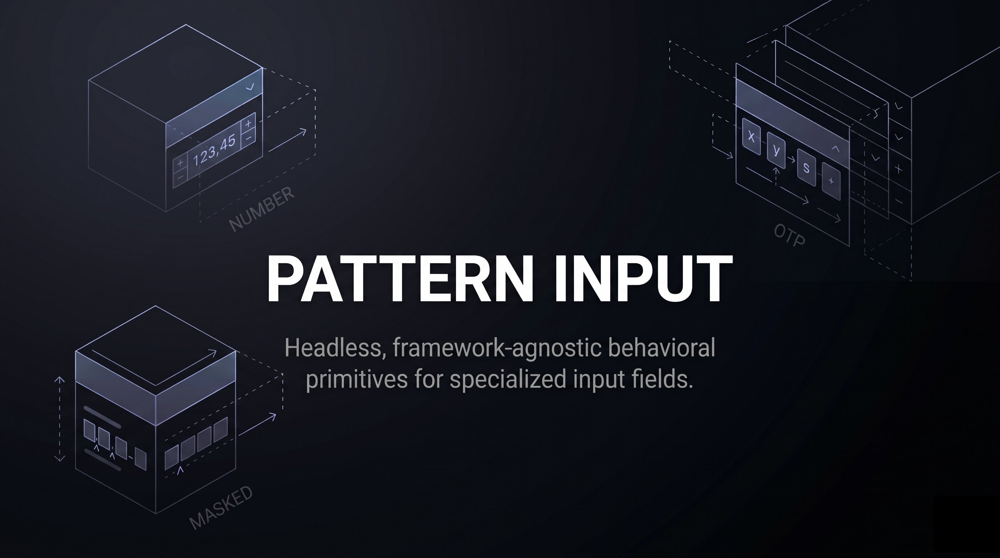

# @zealakit/pattern-input-svelte

[English](https://github.com/zealakit/pattern-input/blob/main/packages/svelte/README.md) | [Tiếng Việt](https://github.com/zealakit/pattern-input/blob/main/packages/svelte/README_VI.md) | [中文](https://github.com/zealakit/pattern-input/blob/main/packages/svelte/README_CN.md)



Factories, actions, and components for number, masked, and one-time-code fields in Svelte 5.

> **Note**
> This package ships no CSS, no classes, and no validation engine. It attaches behavior to elements you own; you keep full control of styling and rules.

## Install

```bash
npm i @zealakit/pattern-input-svelte
npm i @zealakit/ui-engine   # peer
```

`@zealakit/ui-engine` (`^1.0.0-beta.1`) is a required peer dependency.

## Number input

### Quick start

```svelte
<script lang="ts">
  import { NumberInput, createNumberInput, fieldAction } from "@zealakit/pattern-input-svelte";

  let amount = $state<number | null>(null);
  const field = createNumberInput(() => ({ maximumFractionDigits: 2 }));
  $effect.pre(() => { field.sync(); });
  const props = $derived.by(() => { void $field; return field.getInputProps({ id: "price" }); });
</script>

<NumberInput bind:value={amount} id="price-comp" options={{ maximumFractionDigits: 2 }} />
<input {...props} use:fieldAction={field} />
```

### NumberOptions

| Option | Type | Default | Description |
| --- | --- | --- | --- |
| `locale` | `string` | `"en-US"` (`.`, `,`) | Locale used once to resolve decimal and group separators via `Intl.NumberFormat`. |
| `decimalSeparator` | `string` | From `locale` | Explicit decimal separator character (overrides `locale`). |
| `groupSeparator` | `string` | From `locale` | Grouping separator character. Pass `""` to disable grouping. |
| `minimumFractionDigits` | `number` | `0` | Minimum decimal places padded on commit. |
| `maximumFractionDigits` | `number` | `20` | Maximum decimal places accepted while typing or rounded on commit. |
| `rounding` | `"truncate" \| "round-half-up" \| "round-half-even"` | `"round-half-up"` | Rounding mode applied on commit when `value` exceeds `maximumFractionDigits`. |
| `min` | `number` | `—` | Minimum allowed numeric value. |
| `max` | `number` | `—` | Maximum allowed numeric value. |
| `step` | `number` | `1` | Increment/decrement step for `ArrowUp` / `ArrowDown`. |
| `largeStep` | `number` | `step * 10` | Large step for `PageUp` / `PageDown`. |
| `allowNegative` | `boolean` | `min === undefined \| min < 0` | Whether negative numbers and `-` key are accepted. |
| `clampBehavior` | `"blur" \| "none"` | `"blur"` | `"blur"` clamps to `[min, max]` on commit; `"none"` keeps the value and marks `invalid`. |
| `validate` | `(value, ctx) => boolean \| string \| undefined` | `—` | Consumer validation callback run on commit (`false` or string sets `invalid`). |
| `invalid` | `boolean` | `false` | Forces `aria-invalid="true"` externally. |
| `describedBy` | `string` | `—` | Forwarded to `aria-describedby`. |
| `required` | `boolean` | `false` | Forwarded as `aria-required` / `required`. |
| `disabled` | `boolean` | `false` | Disables input interaction. |
| `readOnly` | `boolean` | `false` | Prevents edits while allowing focus and selection. |
| `value` | `number \| null` | `—` | Controlled value (even `null` enables controlled mode). |
| `defaultValue` | `number \| null` | `null` | Initial value for uncontrolled mode. |
| `onValueChange` | `(change: ValueChange<number \| null>) => void` | `—` | Called with `{ value, formattedValue, status, reason }`. |
| `onStatusChange` | `(status: FieldStatus) => void` | `—` | Called when `status` transitions. |

## Masked input

### Quick start

```svelte
<script lang="ts">
  import { MaskedInput, createMaskedInput, fieldAction } from "@zealakit/pattern-input-svelte";

  let tax = $state("");
  const card = createMaskedInput(() => ({
    mask: ["9999 9999 9999 9999", "9999 999999 99999"],
    selectMask: (raw) => (/^3[47]/.test(raw) ? 1 : 0),
  }));
  $effect.pre(() => { card.sync(); });
  const cardProps = $derived.by(() => { void $card; return card.getInputProps({ id: "card" }); });
</script>

<MaskedInput bind:value={tax} id="tax" options={{ mask: "999.999.999-99" }} />
<input {...cardProps} use:fieldAction={card} />
```

### Mask pattern syntax

| Token | Matches | Example |
| --- | --- | --- |
| `9` | Single ASCII digit `[0-9]` | `"999-999"` |
| `a` | Single ASCII letter `[A-Za-z]` | `"aaa-999"` |
| `*` | Single alphanumeric `[A-Za-z0-9]` | `"****"` |
| `\x` | Escaped literal character (`\9`, `\a`, `\*`, `\[`, `\{`, `\\`) | `"\9-999"` |
| `[...]` | Optional section; omitted characters do not prevent `complete` | `"(999) 999-9999[ x999]"` |
| `{n}`, `{n,m}`, `{n,}` | Repeat preceding token (`{n,}` is capped at 64 slots) | `"9{4}-9{2,4}"` |
| Custom key | Single character defined in `tokens` with `{ test, transform? }` | `"AA-9999-HH"` |

### MaskedOptions

| Option | Type | Default | Description |
| --- | --- | --- | --- |
| `mask` | `string \| readonly string[]` | **required** | Pattern string or ordered array of alternative patterns. |
| `tokens` | `Record<string, MaskTokenDefinition>` | `{}` | Custom single-character token definitions (`{ test: RegExp, transform?: "upper" \| "lower" }`). |
| `selectMask` | `(raw: string, alternatives: readonly string[]) => number` | `—` | Custom 0-based selector for array `mask`. Out-of-range results fall back to first match. |
| `showLiterals` | `"filled" \| "always"` | `"filled"` | `"always"` displays the full mask template using `placeholderChar`. |
| `placeholderChar` | `string` | `"_"` | Single-character placeholder shown for unfilled slots when `showLiterals: "always"`. |
| `inputMode` | `"text" \| "numeric"` | Auto | Defaults to `"numeric"` when every slot accepts digits only. |
| `validate` | `(raw, ctx) => boolean \| string \| undefined` | `—` | Consumer validation callback run on commit (`ctx` includes `status` and `formattedValue`). |
| `invalid` | `boolean` | `false` | Forces `aria-invalid="true"` externally. |
| `describedBy` | `string` | `—` | Forwarded to `aria-describedby`. |
| `required` | `boolean` | `false` | Forwarded as `aria-required` / `required`. |
| `disabled` | `boolean` | `false` | Disables input interaction. |
| `readOnly` | `boolean` | `false` | Prevents edits while allowing focus and selection. |
| `value` | `string` | `—` | Controlled raw value (without literals). |
| `defaultValue` | `string` | `""` | Initial raw value for uncontrolled mode. |
| `onValueChange` | `(change: ValueChange<string>) => void` | `—` | Called with `{ value, formattedValue, status, reason }`. |
| `onStatusChange` | `(status: FieldStatus) => void` | `—` | Called when `status` transitions. |

### Phone, multi-mask, and custom token recipes

Use the right pattern strategy for each real-world format. Avoid mixing ambiguous same-digit phone patterns like `["(999) 999-9999", "+9 (999) 999-9999"]` on a single input: typing an 11th digit shifts the area code into the country code. Switch a single exact `mask` per selected country instead.

```ts
// 1. Phone (single mask per selected country — never stack ambiguous lengths)
const PHONE_MASKS = { US: "(999) 999-9999", VN: "9999 999 999" };

// 2. Multi-mask by length (CPF 11 digits / CNPJ 14 digits)
const taxMask = ["999.999.999-99", "99.999.999/9999-99"];

// 3. Prefix-driven selectMask (Amex 4-6-5 vs Standard 4-4-4-4)
const cardOptions = {
  mask: ["9999 9999 9999 9999", "9999 999999 99999"],
  selectMask: (raw: string) => (/^3[47]/.test(raw) ? 1 : 0),
};

// 4. Always-visible template + custom uppercase tokens
const licenseOptions = {
  mask: "AA-9999-HH",
  tokens: {
    A: { test: /[A-Za-z]/, transform: "upper" as const },
    H: { test: /[0-9A-Fa-f]/, transform: "upper" as const },
  },
  showLiterals: "always" as const,
  placeholderChar: "_",
};
```

## One-time code (OTP)

### Quick start

```svelte
<script lang="ts">
  import { InputOTP } from "@zealakit/pattern-input-svelte";

  let code = $state("");
</script>

<InputOTP maxLength={6} bind:value={code} name="code" label="Verification code">
  <InputOTP.Group>
    <InputOTP.Slot index={0} />
    <InputOTP.Slot index={1} />
    <InputOTP.Slot index={2} />
  </InputOTP.Group>
  <InputOTP.Separator>-</InputOTP.Separator>
  <InputOTP.Group>
    <InputOTP.Slot index={3} />
    <InputOTP.Slot index={4} />
    <InputOTP.Slot index={5} />
  </InputOTP.Group>
</InputOTP>
```

### OtpOptions

| Option | Type | Default | Description |
| --- | --- | --- | --- |
| `length` / `maxLength` | `number` | **required** | Number of OTP slots (`1..32`). Components use `maxLength`; core/factories use `length`. |
| `type` | `"numeric" \| "alphanumeric"` | `"numeric"` | Allowed character class for each slot. |
| `transform` | `"upper" \| "lower"` | `—` | Case transformation when `type: "alphanumeric"`. |
| `autocomplete` | `"one-time-code" \| "off"` | `"one-time-code"` | Applied to slot 0 for SMS/OS autofill. |
| `name` | `string` | `—` | Form field name for the hidden aggregate `<input>`. |
| `label` | `string` | `—` | Accessible group `aria-label`. |
| `labelledBy` | `string` | `—` | Accessible group `aria-labelledby`. |
| `describedBy` | `string` | `—` | Forwarded to group `aria-describedby`. |
| `slotLabel` | `(index: number, length: number) => string` | `Character i of n` | Accessible label builder per slot. |
| `validate` | `(raw, ctx) => boolean \| string \| undefined` | `—` | Consumer validation callback run on commit. |
| `invalid` | `boolean` | `false` | Marks group and slots `aria-invalid="true"`. |
| `disabled` | `boolean` | `false` | Disables all slot inputs. |
| `required` | `boolean` | `false` | Marks slots required. |
| `value` | `string` | `—` | Controlled OTP string. |
| `defaultValue` | `string` | `""` | Initial OTP string for uncontrolled mode. |
| `onValueChange` | `(change: ValueChange<string>) => void` | `—` | Called with `{ value, formattedValue, status, reason }`. |
| `onStatusChange` | `(status: FieldStatus) => void` | `—` | Called when `status` transitions. |

## Controlled mode and validation

Pass `value` and `onValueChange` to control a field. `onValueChange` receives `{ value, formattedValue, status, reason }`, where `reason` is `"input" | "paste" | "delete" | "step" | "commit" | "reset" | "undo" | "redo" | "programmatic"`. Not updating `value` rejects the change and keeps the approved text and caret.

`status` is `"empty" | "incomplete" | "complete" | "invalid"`. Incomplete inputs are never marked invalid; `validate` runs on commit (`Enter` or blur), and returning `false` or a string sets `status = "invalid"` and `aria-invalid="true"`. Pair `describedBy` with an error element id to announce messages.

## Contract and lifecycle

Every factory returns a Svelte store plus `value()`, `formattedValue()`, `status()`, `getInputProps(extra?)` (or `getGroupProps()`, `getSlotProps(i)`, `getHiddenInputProps()`), `setValue`, `clear`, `focus`, `undo`, `redo`, `setOptions`, `sync()`, and `attach(node)`. `<NumberInput>`, `<MaskedInput>`, and `<InputOTP>` support `bind:value` and direct HTML attributes. `CONTRACT_VERSION`, `GETTER_NAMES`, `INSTANCE_API`, `PatternInputError`, `MaskPatternError`, and utility types are exported.

## SvelteKit

All imports are SSR-safe. Call `field.sync()` inside `$effect.pre` when using factories, and wrap `getInputProps()` in `$derived.by(() => { void $field; return field.getInputProps(); })` so reactive `aria-invalid` updates reach the DOM.

## Styling hooks

| Selector / Attribute | Where | Purpose |
| --- | --- | --- |
| `input[aria-invalid="true"]` | Number, Masked, OTP slots | Present only when `status === "invalid"` or `invalid: true` (never for incomplete). |
| `input:disabled` | Number, Masked, OTP slots | Applied when `disabled: true`. |
| `input[readonly]` | Number, Masked | Applied when `readOnly: true`. |
| `[role="group"]` | OTP root | Accessible container for horizontal flex/grid layout. |
| `:focus-visible` | All inputs | Use for accessible focus rings. |

```css
input {
  font: inherit;
  font-variant-numeric: tabular-nums;
  padding: 0.55rem 0.75rem;
  border: 1.5px solid #94a3b8;
  border-radius: 8px;
}

input:focus-visible {
  border-color: #2563eb;
  box-shadow: 0 0 0 3px rgba(37, 99, 235, 0.16);
  outline: none;
}

input[aria-invalid="true"] {
  border-color: #dc2626;
  box-shadow: 0 0 0 3px rgba(220, 38, 38, 0.12);
}

[role="group"] {
  display: flex;
  align-items: center;
  gap: 0.5rem;
}

[role="group"] input {
  width: 2.625rem;
  height: 3rem;
  padding: 0;
  text-align: center;
  font-weight: 600;
}
```

## Agent Skill

Add the integration skill for AI coding agents: [Pattern Input Svelte](https://github.com/zealakit/pattern-input/blob/main/skills/pattern-input-svelte.md).

## License

MIT © Zealakit
